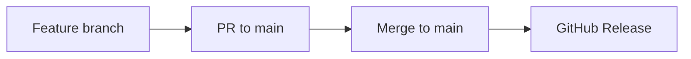

# Release Process

This document describes the complete release process for this repository.

---

## Overview

Releases are driven by GitHub Actions using the reusable
[`purview-dev/build`](https://github.com/purview-dev/build) pipelines. No release steps are
performed manually.

<!-- purview:likec4 file="wiki/diagrams/release-flow.c4" view="releaseFlow" title="Release flow" -->


[LikeC4 model](wiki/diagrams/release-flow.c4)
<!-- /purview:likec4 -->

### Workflow components

| Component | File | Purpose |
| ----------- | ------ | --------- |
| PR gate | `.github/workflows/pr.yml` | Runs the reusable `purview-dev/build` `purview-build.yml` pipeline (restore, build, lint, tests) and builds/tests the sample solution |
| CD pipeline | `.github/workflows/release.yml` | Runs the reusable `purview-dev/build` `purview-release.yml` pipeline on push to `main` |
| Local pipeline | `Justfile` `pipeline-*` recipes | Mirror the CI/CD pipelines locally via the `Purview.Build` local tool (`dotnet purview-build`) |

## Developer workflow

### 1. Make your changes

```bash
git checkout -b feat/my-change
# ... make changes ...
```

### 2. Validate locally

Run the PR gate before pushing:

```bash
just pipeline-pr
```

This restores, builds, lints, and runs the integration tests — the same gate CI enforces.

### 3. Open a PR

```bash
git add .
git commit -m "feat: my change"
git push origin feat/my-change
# Open a PR to main
```

`pr.yml` must pass (build, lint, tests, plus the sample build/test job) before the PR can merge.

### 4. Merge the PR

Merge the PR into `main`.

### 5. Release is published automatically

Merging to `main` triggers `release.yml`, which runs the reusable `purview-release.yml` pipeline:

1. Restores and builds the main and sample solutions.
2. Runs the integration tests.
3. Packs the NuGet package (version read from `package.json`).
4. Publishes the package and creates a GitHub Release.

## Versioning

- The version lives in `package.json`. **Current Version:** `*` (run `just version` to print it)
- It is applied to `Version` / `PackageVersion` by `Purview.BuildSdk` via package.json
  version detection (`UsePackageJsonVersion`, default `true`).
- `just version` prints the current version.
- `just bump major|minor|patch` bumps `package.json`, then syncs the version into docs/samples itself
  (through the `_after-bump` hook, which runs `just update-version`).

### Analyzer release tracking

The `TSG` diagnostics are tracked in `src/src/SourceGenerator/AnalyzerReleases.Shipped.md` and
`src/src/SourceGenerator/AnalyzerReleases.Unshipped.md`. The files are wired up as `AdditionalFiles`,
so the Roslyn release-tracking analyzers validate them on every build (`EnforceExtendedAnalyzerRules`
is enabled by `Purview.BuildSdk`).

1. Add new rules to `AnalyzerReleases.Unshipped.md`.
2. At release time, create a new `## Release <version>` section in `AnalyzerReleases.Shipped.md`,
   move the unshipped entries into it, and leave the unshipped file empty.
3. Keep the rule ID, category, and severity in sync with the `DiagnosticDescriptor`s in
   `src/src/SourceGenerator/Helpers/DiagnosticLibrary.*.cs`.

## Building the package locally

| Command | Purpose |
| --- | --- |
| `just pack` | Updates the version, then packs the NuGet package into `artifacts/`. |
| `just pipeline-local-release` | Packs and publishes to a local NuGet feed (see the Justfile note on argument quoting for the feed path). |
| `just pipeline-release` | Full release pipeline (build, test, pack, publish, GitHub release). |

## Pre-release validation

Before a release, validate locally on a clean tree. Each step must pass.

1. `just scrub` — delete `bin`/`obj`, clean, force-restore, stop build servers.
2. `just pipeline-local-release --PublishLocalNuGet:LocalFeedPath=p:/_sync-projects/.local-nuget/` —
   restore, build, lint, tests, pack, pack validation (including `ForbiddenContent`), local publish.
3. `just smoke-packed-consumers` — the packed-consumer gate: Native AOT, Blazor WebAssembly (trimmed
   and `RunAOTCompilation`) and Blazor Server consumers of the `.nupkg`, each leak-scanned for
   compiler-host assemblies.
4. `just build-s && just test-s` — sample solution build and tests.
5. `just lint-check` — CSharpier reports no change.

After changing `PackValidation`, also run `just verify-pack-rules` (pass `-PackagesFolder <feed>` after
`just pipeline-local-release`, which moves the package out of `artifacts/`).

What each gate proves, and where CI runs it, is in the wiki's
[Release Flow — Release gates](wiki/contributing/Release-Flow.md#release-gates).

## Releasing

1. `just bump major|minor|patch` — bumps `package.json` and syncs docs/samples.
2. Push a PR with the version bump; merge to `main`.
3. `release.yml` publishes the release automatically.

> The legacy `scripts/setup-release.*` files describe a changeset-based (`@changesets/cli`) flow that
> is **not** used by this repository. They are retained for reference only; the actual release
> automation lives in `.github/workflows/pr.yml` and `.github/workflows/release.yml`.